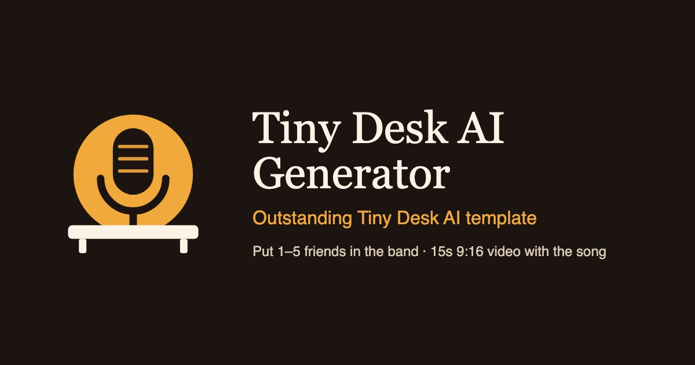

# Tiny Desk AI Generator

Turn 1–5 photos of your friends into a 15-second Tiny Desk style concert video.

**[tinydeskai.studio](https://tinydeskai.studio)** — no signup, guest checkout, $7.99 per video.

## What it does

Upload one to five photos. The first person sings lead, the second plays sax, the rest sing backup, and any empty spots get filled with AI musicians. About a minute later you get a 15-second vertical 720p MP4 with the stage audio, plus a no-music cut for platforms that flag copyrighted audio.

Output: 15s · 9:16 · 720p MP4, with a no-music variant and a GIF.

## How the pipeline works

Two model calls, not one.

1. **Portrait pass.** Every uploaded face gets its own clean, front-facing reference frame. This solves the identity problem on a still image before any motion exists.
2. **Video pass.** The video model is conditioned on those reference frames plus a fixed stage plate, so it only has to preserve an identity it can already see rather than invent one from a small, badly lit, off-angle photo.

The band staging never changes between renders. If the sax player moved seats between takes, every clip would look like a different band, so the staging is fixed and only the faces are swapped in.

Built on [Seedance 2.0](https://seed.bytedance.com/en/seedance) for video and Nano Banana 2 for the identity frames.

## Things worth knowing if you build something similar

- **Multi-person identity consistency is the hard part.** Keeping the same face across a wide, moving stage shot meant generating a reference portrait per person first, then conditioning the video generation on those. Face swap looks fine on a still and falls apart the moment the head turns.
- **Audio sync matters more than resolution.** People forgive 720p, they do not forgive the singer's mouth being off by 200ms. It is the first thing anyone notices and the last thing anyone says out loud.
- **A no-music export is not optional.** TikTok and Reels muting the whole clip is worse than shipping two files, and the no-music cut is also what people use to add their own audio later.
- **Guests should not have to make an account.** It is a guest checkout at $7.99 per video; adding a signup wall cut conversions badly in testing.

## Status

Live. Actively being improved.

## Feedback

If you try it, tell me what breaks. Especially curious about group photos with more than three people, where people stand at different depths and the parallax gives the model the most trouble.

## Writing about it

- [dev.to](https://dev.to/zaireprow/i-built-a-tiny-desk-ai-generator-that-turns-one-photo-into-a-15-second-concert-video-1e4a)
- [Hashnode](https://tinydeskai.hashnode.dev/i-built-a-tiny-desk-ai-generator-that-turns-one-photo-into-a-15-second-concert-video)
- [Medium](https://medium.com/@zaireprow83067/i-built-a-tiny-desk-ai-generator-that-turns-one-photo-into-a-15-second-concert-video-149596f68af2)
- [Qiita](https://qiita.com/zaireprow/items/420c3cdcf9adc4ea7a12)
- [note](https://note.com/zaireprow/n/n4fb001035dbc)
